# 集中监测模块_集中监测_产品需求规格说明书

> 截图说明：除 2.1.6、2.2.9、2.3.7 新版右侧预警/告警清单截图外，本文截图从 V0.0.1 恢复，用于对应模块的布局参考。历史截图中的旧版页面名称、导航入口、状态名称、健康度单位及预警/告警展示样式和范围，以 V0.0.4 正文规则为准；三个页面右侧清单分别以对应章节的新版截图为准。

## 版本历史

| 版本号    | 作者  | 描述                                                                   | 日期         |
| ------ | --- | -------------------------------------------------------------------- | ---------- |
| V0.0.4 | 支菡倩 | 三个页面右侧清单统一为四类单选筛选按钮，支持再次点击取消筛选；清单及拓扑图仅展示一级/二级预警和故障/告警；补充新版清单截图 | 2026-10-28 |
| V0.0.3 | 支菡倩 | SOS = 100 状态更名为“无风险”；首页卡片健康度增加 % 单位；明确通讯状态判定规则；场站及子系统功率趋势时间窗口限制为不超过 24 小时 | 2026-09-20 |
| V0.0.2 | 支菡倩 | 更新集中监测页单场站卡片通讯图标、站级监测入口与场站单选搜索；移除集中监测模块下的安全诊断相关页面；右侧清单去除数据类告警并更新相关截图 | 2026-07-01 |
| V0.0.1 | 支菡倩 | 初版                                                                   | 2026-06-03 |

## 名词解释

| 名称  | 解释                                     |
| --- | -------------------------------------- |
| SOS | State of Safety，安全状态指数，数值范围 0-100      |
| SOH | State of Health，健康状态指数/健康度，数值范围 0-100% |
| SOC | State of Charge，荷电状态，数值范围 0-100%       |
| SOP | State of Power，当前可用功率                  |
| SOE | State of Energy，当前可用电量                 |
| 预警  | 云端算法基于运行数据、模型规则生成的风险预警，分为一二三级，其中一级最为严重 |
| 告警  | SCADA系统上送的设备侧故障/告警事件                   |

## 全局通用规则

### SOS 数值显示规则（可配置）

| SOS 范围        | 显示       |
| ------------- | -------- |
| SOS = 100     | 100      |
| SOS = 0       | 0        |
| 0 < SOS < 100 | 保留 2 位小数 |

### 风险等级规则（可配置）

| SOS 范围          | 风险等级 | 颜色建议 |
| --------------- | ---- | ---- |
| SOS < 60        | 高风险  | 红色   |
| 60 <= SOS < 80  | 中风险  | 黄色   |
| 80 <= SOS < 100 | 低风险  | 绿色   |
| SOS = 100       | 无风险   | 蓝色   |

### 场站通讯状态规则

通讯中断：全子系统无信号。

部分通讯正常：部分子系统无信号，其余子系统有信号。

通讯正常：全子系统有信号。

离线：无实时数据。

离线场站按无实时数据展示为离线；实时场站按各子系统当前是否有信号判定通讯状态，具体颜色及交互影响如下。

| 通讯状态   | 适用场站类型 | 展示颜色 | 交互影响                          |
| ------ | ------ | ---- | ----------------------------- |
| 通讯正常   | 实时     | 绿色   | 支持查看所有实时指标、站端告警、云端预警          |
| 部分通讯正常 | 实时     | 黄色   | 通讯中断部分的实时指标、站端告警展示数据中断前的最新有效值 |
| 通讯中断   | 实时     | 红色   | 实时指标、站端告警展示通讯中断前的最新有效值        |
| 离线     | 离线     | 灰色   | 实时指标、站端告警展示离线数据的最新有效值         |

## 一、功能清单总览

本文档涉及“集中监测”模块下三个页面。功能类型区分为：前端展示功能、前端交互功能、后台自动功能。本版本功能优先级均为 P0（必须实现）。

| 序号  | 页面          | 功能名称           | 功能类型        | 优先级 |
| --- | ----------- | -------------- | ----------- | --- |
| 1   | 集中监测主页面     | 场站搜索           | 前端交互功能      | P0  |
| 2   | 集中监测主页面     | 场站排序           | 前端交互功能      | P0  |
| 3   | 集中监测主页面     | 场站状态筛选         | 前端交互功能      | P0  |
| 4   | 集中监测主页面     | 场站卡片列表         | 前端展示&交互功能   | P0  |
| 5   | 集中监测主页面     | 场站卡片收起/展开      | 前端交互功能      | P0  |
| 6   | 集中监测主页面     | 右侧预警/告警清单      | 前端展示&交互功能   | P0  |
| 7   | 集中监测主页面     | 预警处理弹窗         | 前端展示&后台自动功能 | P0  |
| 8   | 站级监测页       | 页面入口、场站搜索与顶部信息 | 前端展示&交互功能   | P0  |
| 9   | 站级监测页       | 单站指标卡          | 前端展示功能      | P0  |
| 10  | 站级监测页       | 场站运行           | 前端展示功能      | P0  |
| 11  | 站级监测页       | 场站属性           | 前端展示功能      | P0  |
| 12  | 站级监测页       | 充放电统计          | 前端展示&交互功能   | P0  |
| 13  | 站级监测页       | 场站拓扑图          | 前端展示&交互功能   | P0  |
| 14  | 站级监测页       | 场站功率趋势         | 前端展示&交互功能   | P0  |
| 15  | 站级监测页       | 场站充放电表现        | 前端展示&交互功能   | P0  |
| 16  | 站级监测页       | 单站预警/告警清单      | 前端展示&交互功能   | P0  |
| 17  | 单子系统-子系统概览页 | 页面入口与顶部信息      | 前端展示功能      | P0  |
| 18  | 单子系统-子系统概览页 | 子系统运行          | 前端展示功能      | P0  |
| 19  | 单子系统-子系统概览页 | 子系统充放电统计       | 前端展示&交互功能   | P0  |
| 20  | 单子系统-子系统概览页 | 子系统拓扑图         | 前端展示&交互功能   | P0  |
| 21  | 单子系统-子系统概览页 | 子系统功率趋势        | 前端展示&交互功能   | P0  |
| 22  | 单子系统-子系统概览页 | 子系统充放电表现       | 前端展示&交互功能   | P0  |
| 23  | 单子系统-子系统概览页 | 子系统预警/告警清单     | 前端展示&交互功能   | P0  |

## 二、功能详细描述

### 2.1 集中监测主页面 (Central Monitoring)

进入方式：左侧导航进入“全景监测-集中监测”。

集中监测主页面用于全量场站集中查看，核心任务是监测各场站实时状态、快速定位风险场站、查看场站运行关键指标，并在右侧同步查看当前活跃的预警/告警清单。

界面截图：

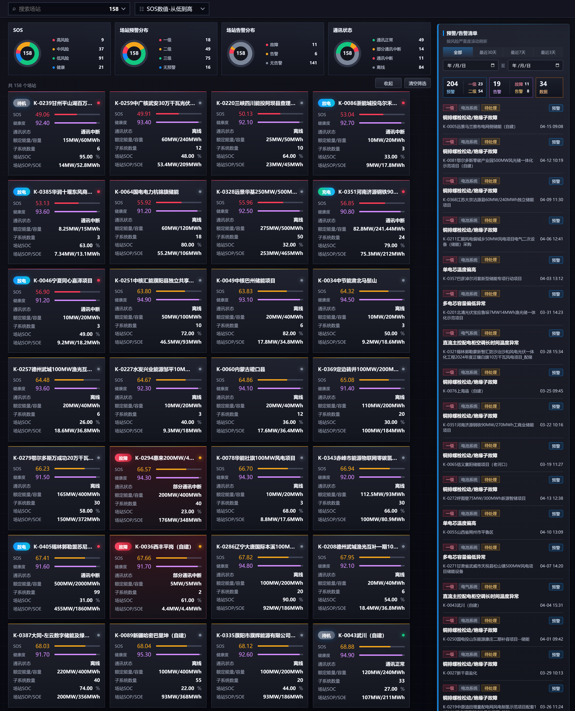

#### 2.1.1 页面布局

功能概述：

定义集中监测主页面的整体信息架构和区域布局。

输入：

- 用户权限范围。
- 场站集合。
- 当前筛选状态。

输出：

- 页面布局。
- 各区域内容。

| 区域    | 内容                     | 说明               |
| ----- | ---------------------- | ---------------- |
| 顶部筛选区 | 场站搜索、场站排序              | 用于快速定位场站         |
| 状态筛选区 | SOS、场站预警分布、场站告警分布、通讯状态 | 点击统计卡片可筛选对应状态场站  |
| 场站卡片区 | 全量场站卡片                 | 支持卡片点击进入站级监测页    |
| 右侧清单区 | 预警/告警清单                | 支持分类筛选、时间筛选、详情查看 |

#### 2.1.2 场站搜索 (Station Search)

界面截图：

功能概述：

支持按场站号或场站名称关键字快速定位目标场站。

输入：

- 搜索关键字。
- 资产树。

输出：

- 匹配后的场站列表。
- 匹配数量。

计算规则：

1. 对编号和名称进行模糊匹配。
2. 与当前筛选、排序条件叠加生效。
3. 点击“清空筛选”后，恢复默认列表。

展示要求：

- 输入后实时刷新。
- 无匹配结果展示空态。
- 筛选后右侧预警/告警清单同步按当前场站集合刷新。

数据来源：

- 资产树。

#### 2.1.3 场站排序

界面截图：

功能概述：

支持按指定字段调整场站展示顺序。

输入：

- 当前场站集合。
- 每个场站最新 SOS。
- 场站编号。

输出：

- 排序后的场站卡片列表。

计算规则：

1. 默认按 SOS 从低到高。
2. 空值置底。
3. 切换选项后立即重排。

展示要求：

- 排序控件展示当前选项。

数据来源：

- 资产树。
- SOS 计算结果表。

可配置参数：

| 参数字段 | 默认值         |
| ---- | ----------- |
| 默认排序 | SOS 数值-从低到高 |
| 空值策略 | 空值置底        |

排序项说明如下：

| 排序项         | 规则        |
| ----------- | --------- |
| SOS 数值-从低到高 | 高风险场站优先展示 |
| SOS 数值-从高到低 | 无风险场站优先展示  |
| 场站编号-顺序     | 按场站编号升序展示 |
| 场站编号-倒序     | 按场站编号降序展示 |

#### 2.1.4 状态筛选卡片

界面截图：

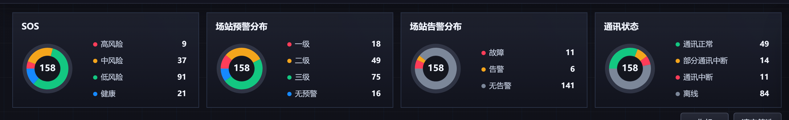

功能概述：

展示场站的SOS、预警、告警、通讯状态分布，并支持点击筛选。

输入：

- 当前场站集合。
- 每个场站最新 SOS。
- 预警集合。
- 告警集合。
- 每个场站当前通讯状态。

输出：

- 分布统计结果。
- 筛选后的列表。

计算规则：

1. 按等级或状态字段聚合数量。
2. 点击环图或图例中的某一分类后，对下方场站卡片进行筛选。
3. 不同统计卡片之间不支持组合筛选。
4. 点击“清空筛选”后，恢复默认列表。

展示要求：

- 选中项的对应图例标签高亮。
- 筛选后右侧预警/告警清单同步按当前场站集合刷新。

状态筛选区包含以下统计卡片：

| 卡片     | 统计内容                    | 点击筛选规则                 |
| ------ | ----------------------- | ---------------------- |
| SOS    | 高风险、中风险、低风险、无风险场站数量      | 点击某风险等级后，仅展示该风险等级场站    |
| 场站预警分布 | 一级、二级、三级、无预警场站数量        | 点击某预警等级后，仅展示命中该预警等级的场站 |
| 场站告警分布 | 故障、告警、无告警场站数量           | 点击某告警状态后，仅展示命中该状态的场站   |
| 通讯状态   | 通讯正常、部分通讯正常、通讯中断、离线场站数量 | 点击某通讯状态后，仅展示命中该通讯状态的场站 |

数据来源：

- 云端预警结果表。
- 站端 SCADA。
- SOS 计算结果表。

#### 2.1.5 场站卡片列表

界面截图：

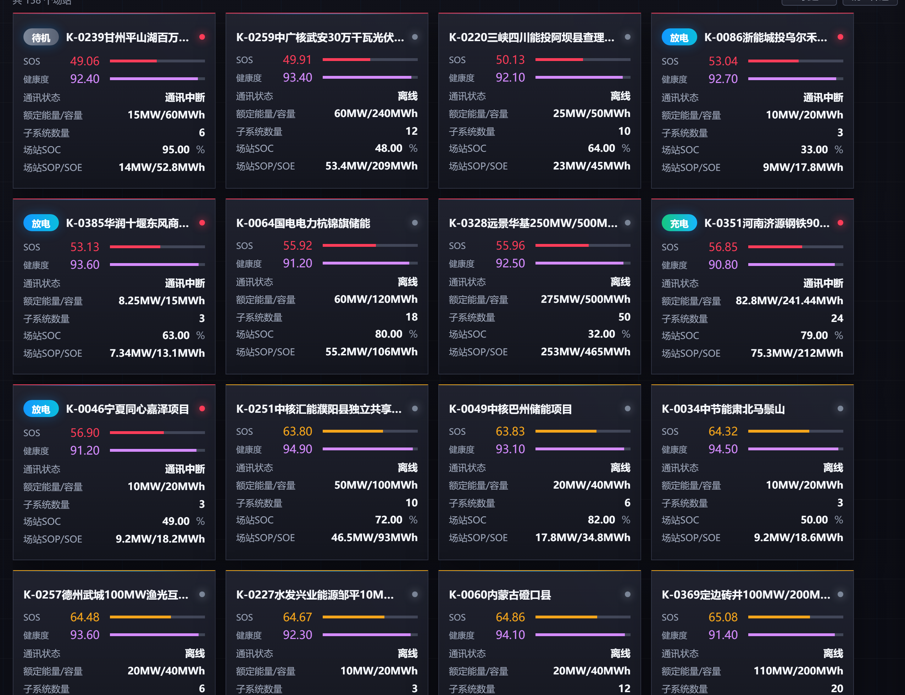

收起状态截图：

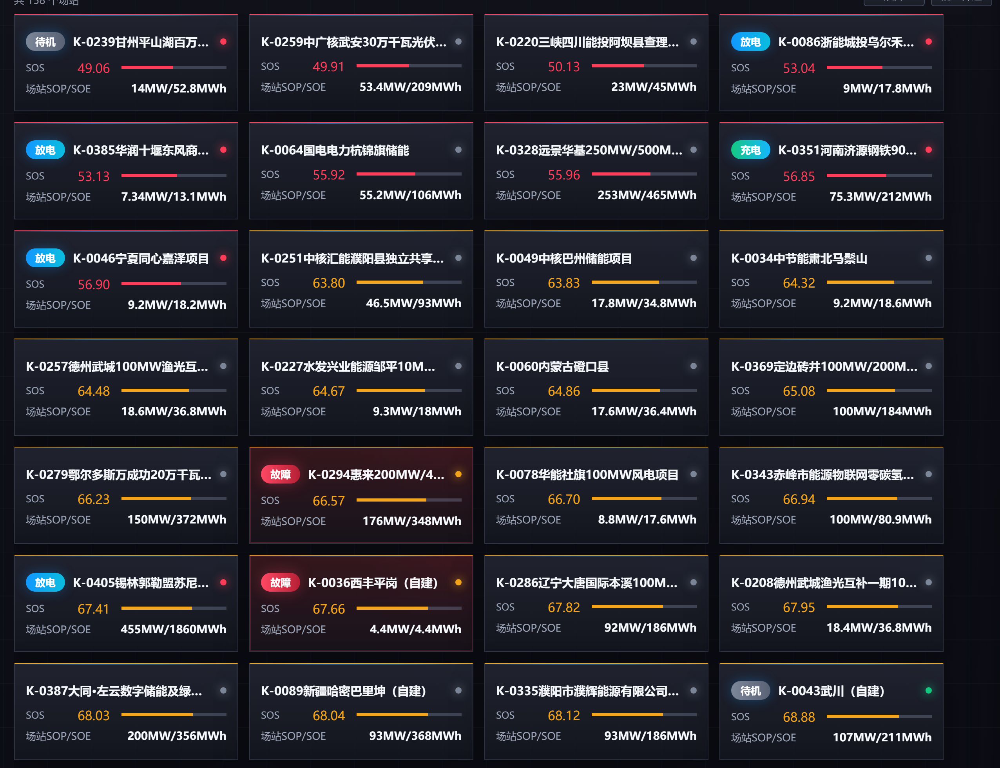

功能概述：

展示当前筛选范围内的场站卡片集合，用于快速对比各场站风险状态、运行状态和关键运行指标，并提供进入单站详情的入口。

输入：

- 当前筛选后的场站集合。
- 场站基础信息：场站编号、场站名称、额定功率、额定容量、子系统数量。
- 场站状态信息：运行状态、通讯状态、站端告警、SOC、SOP/SOE。
- 场站指标信息：SOS、健康度。
- 当前卡片展示状态：展开态或收起态。

输出：

- 场站卡片列表。
- 每张卡片的状态标签、通讯图标、风险颜色、关键指标和点击入口。
- 收起/展开后的卡片展示状态。

计算规则：

1. 按当前搜索、排序、状态筛选条件生成待展示场站集合。
2. 卡片顶部边框色按场站最新 SOS 计算出的风险等级展示，SOS 风险等级优先级为：高风险 > 中风险 > 低风险 > 无风险。
3. 卡片内部底色按场站当前最高站端告警状态展示，优先级为：故障 > 告警 > 无告警。存在故障时使用红色告警底色；无故障但存在告警时使用黄色告警底色；无告警时使用默认深色底色。
4. 左上角状态标签按“站端告警优先、运行状态补充”的规则计算：存在故障时展示“故障”；无故障但存在告警时展示“告警”；无故障/告警且非离线时展示场站运行状态；离线且无故障/告警时不展示左上角运行标签。
5. 右上角通讯图标按场站通讯状态字段展示，对于实时场站包含通讯正常、部分通讯正常、通讯中断，对于离线场站展示离线。
6. 展开态展示完整指标；收起态隐藏健康度及部分明细字段，仅保留核心识别信息、SOS 和场站SOP/SOE。

展示要求：

- 展开态用于完整查看场站运行指标，卡片高度保持常规展示高度。
- 收起态用于提升同屏场站数量，卡片高度压缩为紧凑展示高度，按钮文字由“收起”切换为“展开”。
- 收起状态下，卡片仍需保留场站编号/名称、运行状态、通讯状态、SOS、风险颜色和 SOP/SOE 等核心信息。
- 点击“收起”后，场站卡片区进入紧凑展示态；点击“展开”后恢复完整卡片展示态。
- 卡片颜色需区分“安全风险”和“告警/故障”两类信息：顶部边框表达 SOS 风险等级，卡片内部底色表达站端告警/故障状态，两者同时存在时需同时展示。
- 左上角状态标签用于表达当前最需要用户关注的运行/告警状态，右上角通讯图标用于表达通讯状态，两者互不替代。

卡片顶部边框颜色（SOS 风险等级）：

参考全局通用规则中的风险等级规则。

卡片内部底色（站端告警/故障）：

| 站端状态 | 触发条件             | 内部底色   | 展示优先级 |
| ---- | ---------------- | ------ | ----- |
| 故障   | 场站存在故障级站端告警      | 红色告警底色 | 最高    |
| 告警   | 场站无故障，但存在告警级站端告警 | 黄色告警底色 | 次高    |
| 无告警  | 场站无故障、无告警        | 默认深色底色 | 最低    |

左上角状态标签：

| 展示内容 | 触发条件             | 标签颜色    | 说明           |
| ---- | ---------------- | ------- | ------------ |
| 故障   | 场站存在故障级站端告警      | 红色      | 覆盖运行状态展示     |
| 告警   | 场站无故障，但存在告警级站端告警 | 黄色      | 覆盖运行状态展示     |
| 充电   | 无故障/告警，场站运行状态为充电 | 绿色-蓝色渐变 | 展示实时运行状态     |
| 放电   | 无故障/告警，场站运行状态为放电 | 蓝色-青色渐变 | 展示实时运行状态     |
| 待机   | 无故障/告警，场站运行状态为待机 | 灰色      | 展示实时运行状态     |
| 停机   | 无故障/告警，场站运行状态为停机 | 深灰色     | 展示实时运行状态     |
| 不展示  | 场站通讯状态为离线        | 无       | 避免将离线误判为运行状态 |

右上角通讯图标：

| 通讯状态   | 图标颜色 | 展示内容                   |
| ------ | ---- | ---------------------- |
| 通讯正常   | 绿色   | 右上角绿色通讯图标，悬停提示“通讯正常”   |
| 部分通讯正常 | 黄色   | 右上角黄色通讯图标，悬停提示“部分通讯正常” |
| 通讯中断   | 红色   | 右上角红色通讯图标，悬停提示“通讯中断”   |
| 离线     | 灰色   | 右上角灰色通讯图标，悬停提示“离线”     |

卡片字段：

| 字段         | 说明                 |
| ---------- | ------------------ |
| 场站编号+场站名称  | 场站唯一识别信息           |
| 运行状态       | 充电、放电、待机、停机、告警、故障等 |
| SOS        | 当前场站安全指数           |
| 健康度 | 当前场站健康度，数值后显示 % 单位（如 95%），收起态不展示 |
| 额定能量/容量    | 场站额定功率、额定容量，收起态不展示 |
| 子系统数量      | 当前场站下属子系统数量，收起态不展示 |
| 场站 SOC     | 当前场站荷电状态，收起态不展示    |
| 场站 SOP/SOE | 当前可用功率/可用电量        |

收起/展开规则：

| 状态  | 按钮文案 | 展示内容                               | 使用场景           |
| --- | ---- | ---------------------------------- | -------------- |
| 展开态 | 收起   | 展示完整场站卡片指标                         | 需要查看单个场站完整运行信息 |
| 收起态 | 展开   | 展示场站基础信息、运行/通讯状态、SOS、SOP/SOE 等核心信息 | 需要在同屏快速浏览更多场站  |

数据来源：

- 资产树。
- SOS 计算结果表。
- 云端预警结果表。
- 站端 SCADA。

#### 2.1.6 右侧预警/告警清单 (Warning/Alarm List)

界面截图：

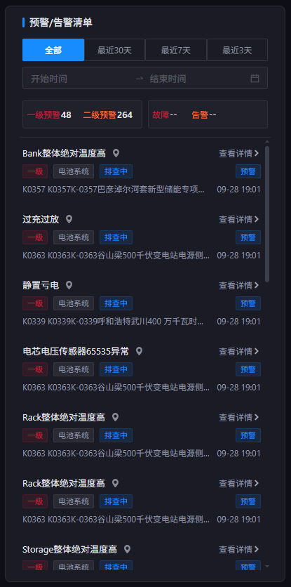

功能概述：

展示当前筛选范围内的预警/告警清单，并提供查看或处理入口。

输入：

- 当前页面已选的场站范围。
- 用户选择的一级预警、二级预警、故障或告警筛选按钮。
- 用户选择的时间范围或自定义日期区间。
- 当前筛选范围内产生活跃状态的一级/二级预警和故障/告警记录，不包含三级预警和数据类告警。

输出：

- 右侧清单展示符合筛选条件的预警/告警卡片。
- 清单顶部展示一级预警、二级预警、故障、告警四类数量。
- 每条记录提供查看详情或进入处理的操作入口。
- 鼠标悬停某条预警/告警记录时，展示该记录对应的“位置”信息。
- 点击清单卡片后打开详情弹窗，弹窗样式、字段和交互与“预警管理”页详情弹窗保持一致。

计算规则：

1. 根据当前场站筛选结果，仅展示筛选范围内关联场站的预警和告警。
2. 类型筛选仅包含“一级预警”“二级预警”“故障”“告警”四个按钮。默认均未选中，展示上述四类记录；点击某个按钮后，仅该按钮高亮，下方清单仅展示对应类型；点击其他按钮时切换筛选类型，再次点击已选按钮时取消类型筛选，恢复展示四类记录。
3. 时间筛选切换时，按全部、最近30天、最近7天、最近3天或自定义日期区间刷新清单。
4. 清单默认按风险严重度优先、发生时间倒序排列；同等级事件优先展示较新的记录。
5. 事件处理完成后，同步刷新清单状态、统计数量和对应场站卡片状态。
6. 类型筛选与场站、时间筛选共同生效；取消类型筛选时保留当前场站和时间范围。四类统计数量按当前场站、时间范围分别统计，不包含三级预警和数据类告警。

展示要求：

- 清单卡片需展示预警/告警名称、类型、等级、场站、位置、设备模块、处理状态、事件时间。
- 右侧清单区域高度固定，内容超出时在清单内部滚动，不影响主页面场站卡片区域。
- 四个类型筛选按钮按截图分为两组排列：左侧为一级预警、二级预警，右侧为故障、告警；每个按钮展示类型名称和对应数量，分组外框不作为额外筛选入口。
- 同一时刻最多一个类型按钮高亮，未选中和选中状态需明显区分；不再提供“预警”“告警”两类总标签。上方时间筛选保留，与类型筛选独立。
- 一级预警、故障使用红色标识，二级预警、告警使用橙色标识。统计数量随时间范围、日期区间和场站筛选结果更新；截图中的数量仅为示例，以实际数据为准。
- 鼠标悬停清单卡片时，需展开该记录完整“位置”信息。
- 点击清单卡片后打开详情弹窗，弹窗内容、按钮、处理入口、关闭方式与“预警管理”页详情弹窗一致。
- 无符合条件数据时展示空态文案，并隐藏无效操作按钮。

数据来源：

- 云端预警结果表。
- 站端 SCADA。

可配置参数：

| 参数字段   | 默认值 |
| ------ | --- |
| 默认时间范围 | 全部  |

### 2.2 站级监测页 (Station-Level Monitoring)

进入方式：点击左侧导航“全景监测-集中监测-站级监测”进入，默认展示当前 SOS 数值最低的场站；也可点击集中监测主页面的单场站卡片，直接进入该场站的站级监测页。

站级监测页用于查看单个场站的运行状态、核心指标、拓扑结构、功率趋势、充放电表现及该场站下的预警/告警。

界面截图：

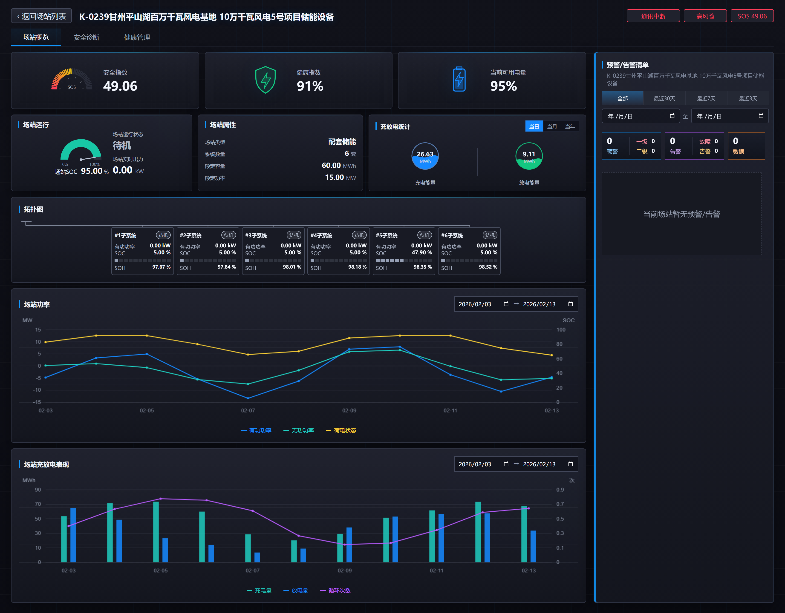

#### 2.2.1 页面入口、场站搜索与顶部信息 (Page Entry, Site Search and Header Information)

功能概述：

展示站级监测页顶部导航、场站单选搜索框及当前场站关键状态，用于确认当前查看场站，并支持在站级监测页内切换其他场站。

输入：

- 用户从左侧导航“全景监测-集中监测-站级监测”进入，或从集中监测主页面点击单场站卡片进入。
- 当前选中的场站；从左侧导航进入时，默认取全量场站中 SOS 数值最低的场站。
- 场站单选搜索关键词。
- 当前场站编号、名称、通讯状态、风险等级和 SOS 安全指数。

输出：

- 打开所选场站的站级监测页。
- 顶部展示场站单选搜索框、场站名称、场站编号、通讯状态、风险等级和 SOS 安全指数。
- 切换场站后，刷新当前页所有功能模块及右侧预警/告警清单。

计算规则：

- 从集中监测主页面点击单场站卡片进入时，当前页展示被点击场站的数据。
- 从左侧导航进入站级监测页时，系统按当前筛选范围内最新 SOS 数值升序取最低值场站作为默认场站。
- 场站搜索框为单选控件，用户选择新场站后，当前页全部模块按新场站重新取数并刷新。
- 场站顶部风险等级按当前场站最新 SOS 安全指数区间换算。

展示要求：

- 站级监测页作为左侧导航“集中监测”下方的二级页面展示。
- 顶部场站搜索框样式参考集中监测主页面上方场站搜索筛选框，区别为仅支持单选。
- 搜索框支持输入场站名称或编号进行模糊搜索，选择后收起下拉列表并展示当前选中场站。
- 顶部信息区展示当前场站名称、编号、通讯状态、风险等级和 SOS 安全指数，字段布局保持与原站级页面顶部信息一致。

数据来源：

- 资产树。
- SOS 计算结果表。
- 站端 SCADA。

可配置参数：

| 参数     | 默认值            | 说明                   |
| ------ | -------------- | -------------------- |
| 默认场站规则 | 最新 SOS 数值最低    | 从左侧导航进入时默认展示的场站选择规则。 |
| 搜索匹配字段 | 场站名称、场站编号      | 场站单选搜索框支持匹配的字段。      |
| 搜索选择模式 | 单选             | 站级监测页顶部搜索框仅允许选择一个场站。 |
| 风险等级区间 | 低风险/中风险/高风险/无风险 | 顶部风险等级与颜色映射规则。       |

#### 2.2.2 单站指标卡

界面截图：

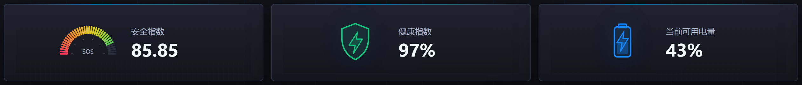

功能概述：

以卡片形式展示当前场站最核心的安全、健康和可用电量指标，用于快速判断该场站当前整体状态。

输入：

- 当前场站的最新 SOS 。
- 当前场站的最新健康指数。
- 当前场站的可用电量。

输出：

- 安全指数、健康指数、当前可用电量三张指标卡。
- 每张卡展示指标名称、当前值、单位和对应图标。

计算规则：

1. 安全指数、健康指数取当前场站最新有效值。
2. 当前可用电量按场站最新 SOE 数据计算后展示。
3. 指标值按配置保留小数位，单位按字段类型展示。
4. 数据为空时，数值展示 `--`，不参与颜色判断。

展示要求：

- 安全指数颜色遵循全局 SOS 风险等级规则。
- 健康指数和可用电量使用与页面视觉体系一致的进度或仪表样式。
- 数据为空时展示 `--`，图形区域展示空态，不展示错误颜色。

数据来源：

- SOS 计算结果表。
- 健康度计算结果表。
- 站端 SCADA。

#### 2.2.3 场站运行 (Site Operation)

界面截图：

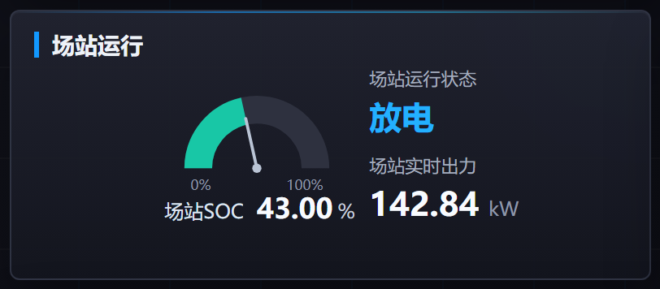

功能概述：

展示当前场站的实时运行状态、SOC 和实时出力，帮助用户判断场站正在充电、放电、待机、停机或离线。

输入：

- 当前场站运行状态。
- 当前场站 SOC。
- 当前场站实时出力。

输出：

- 场站运行状态文本和状态颜色。
- 场站 SOC 当前值及单位。
- 场站实时出力当前值及单位。
- 离线或数据缺失时的占位展示。

计算规则：

1. 运行状态取当前场站最新运行状态，对于实时场站展示充电、放电、待机、停机，对于离线场站展示离线。
2. SOC 和实时出力取最新有效值。
3. 场站离线时，运行状态展示“离线”，SOC、实时出力展示最新一次有效值。

展示要求：

- 运行状态需用文本和颜色共同表达，颜色规则与集中监测主页面保持一致。
- SOC、实时出力需明确单位，数值保留位数按可配置参数执行。

字段说明：

| 字段     | 说明              |
| ------ | --------------- |
| 场站 SOC | 当前场站荷电状态        |
| 场站运行状态 | 充电、放电、待机、停机、离线等 |
| 场站实时出力 | 当前实时功率，单位 kW    |

数据来源：

- 站端 SCADA。

#### 2.2.4 场站属性 (Site Attributes)

界面截图：

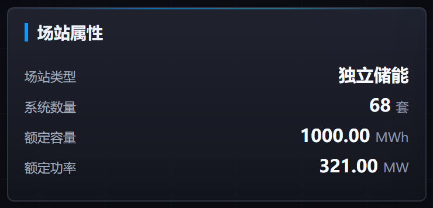

功能概述：

展示当前场站的基础建设属性，包括场站类型、系统数量、额定容量和额定功率，作为运行指标和拓扑信息的基础说明。

输入：

- 资产树。

输出：

- 场站类型。
- 系统数量。
- 额定容量。
- 额定功率。

计算规则：

1. 场站类型、系统数量、额定容量、额定功率均由资产树获取。

展示要求：

- 容量、功率字段必须带单位。
- 系统数量与下方场站拓扑图中的子系统数量保持一致。
- 缺失字段统一展示 `--`。

数据来源：

- 资产树。

#### 2.2.5 充放电统计 (Charge/Discharge Statistics)

界面截图：

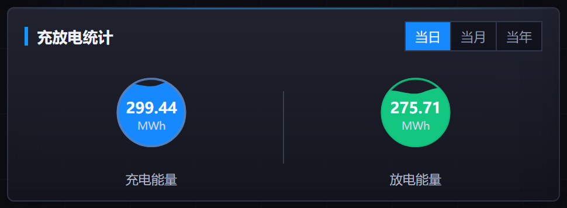

功能概述：

展示当前场站在当日、当月、当年不同周期内的充电总量和放电总量，并支持用户切换统计周期。

输入：

- 当前场站充电电量统计数据。
- 当前场站放电电量统计数据。
- 用户选择的统计周期：当日、当月或当年。

输出：

- 所选周期内的充电总量。
- 所选周期内的放电总量。
- 当前选中的统计周期状态。

计算规则：

1. 默认展示当日充电总量和放电总量。
2. 用户切换“当月”时，展示当前自然月累计充电量和放电量。
3. 用户切换“当年”时，展示当前自然年累计充电量和放电量。
4. 统计数据按场站维度汇总，单位统一为 MWh。
5. 数据缺失时展示 `--`，不以 0 代替未知数据。

展示要求：

- 当日、当月、当年切换按钮需突出当前选中项。
- 充电总量和放电总量需并列展示，单位明确。
- 周期切换后，数值需立即刷新，避免保留上一周期数据。
- 数据为空时展示 `--`，并保留指标名称和单位位置。

数据来源：

- 场站充放电统计表。

可配置参数：

| 参数字段 | 默认值           |
| ---- | ------------- |
| 统计周期 | 当日/当月/当年，默认当日 |

#### 2.2.6 场站拓扑图 (Site Topology)

界面截图：

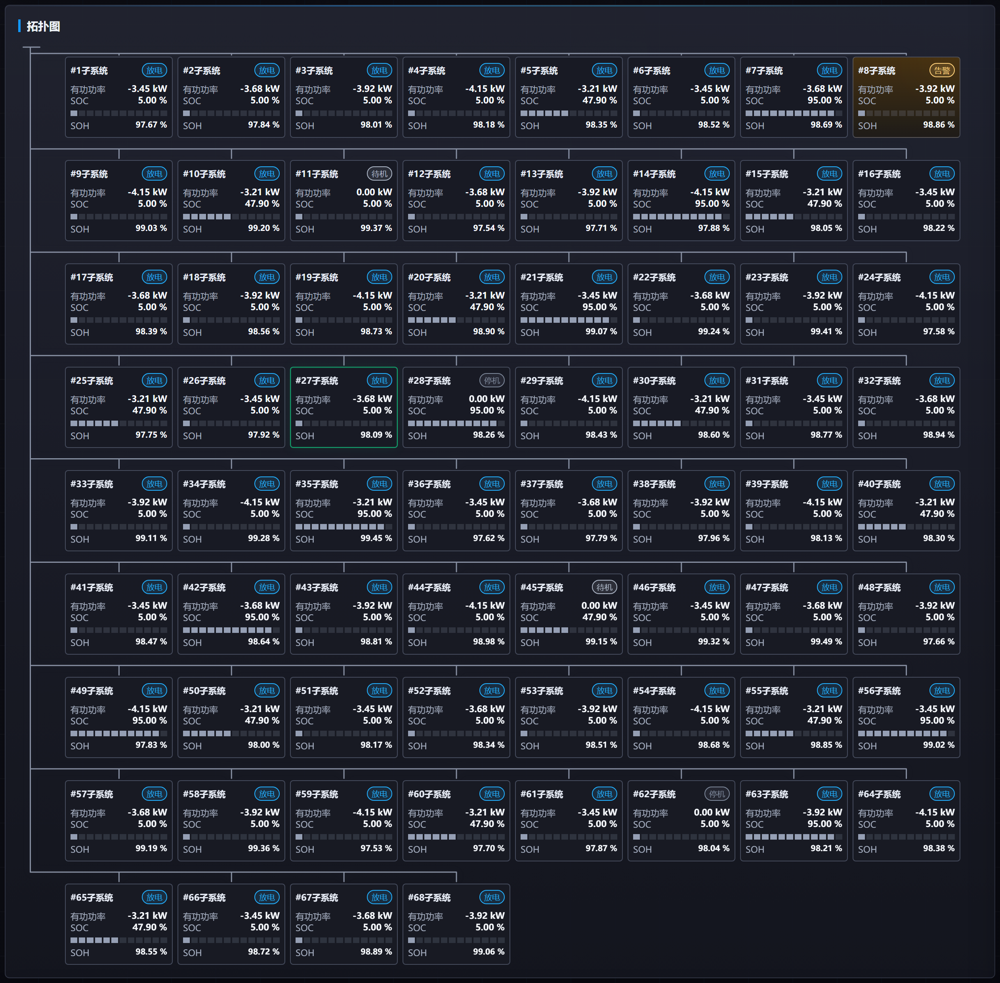

功能概述：

展示场站内各子系统的拓扑关系。

输入：

- 资产树。
- 各子系统运行状态、通讯状态和风险状态。
- 各子系统 PCS 功率、SOC、SOH 等关键运行指标。
- 各子系统关联的预警和告警信息。

输出：

- 当前场站的子系统拓扑卡片。
- 每个子系统的名称、状态、关键指标和异常提示。
- 点击子系统卡片后的页面跳转入口。

计算规则：

1. 按当前场站资产树生成子系统拓扑卡片（以母线划分）。
2. 子系统卡片边框色仅按该子系统关联的一级/二级预警中最高等级展示，优先级为：一级 > 二级 > 无一级/二级预警。三级预警不参与拓扑图展示和边框颜色判定。
3. 子系统卡片主体底色按该子系统关联站端告警状态展示，优先级为：故障 > 告警 > 无告警。存在故障时使用红色告警底色；无故障但存在告警时使用黄色告警底色；无告警时使用默认深色底色。
4. 右上角状态标签按“告警/故障优先、通讯状态其次、运行状态补充”的规则展示：存在故障时展示“故障”；无故障但存在告警时展示“告警”；无故障/告警但场站离线时展示“离线”；其余情况展示子系统运行状态。
5. 子系统关键指标取最新有效值，缺失时展示 `--`。
6. 点击子系统卡片后进入对应“单子系统-子系统概览页”。

展示要求：

- 子系统卡片需展示连接关系、子系统名称和关键运行指标。
- 卡片颜色需区分“预警风险”和“告警/故障”两类信息：卡片边框表达关联预警最高等级，卡片主体底色表达站端告警/故障状态，两者同时存在时需同时展示。
- 鼠标悬浮时仅展示该子系统关联的一级/二级预警和故障/告警摘要，不包含三级预警和数据类告警，与右侧清单展示范围一致。
- 子系统数量较多时支持页面滚动查看。

子系统卡片边框颜色（关联预警最高等级）：

| 预警最高等级 | 触发条件                | 边框颜色 | 说明                |
| ------ | ------------------- | ---- | ----------------- |
| 一级预警   | 子系统存在一级预警           | 红色   | 子系统存在最高等级预警，需优先关注 |
| 二级预警   | 子系统无一级预警，但存在二级预警    | 黄色   | 子系统存在中等级预警        |
| 无一级/二级预警 | 子系统无关联一级/二级预警 | 默认灰色 | 不展示一级/二级预警风险边框提示 |

子系统卡片主体底色（站端告警/故障）：

| 站端状态 | 触发条件              | 主体底色   | 展示优先级 |
| ---- | ----------------- | ------ | ----- |
| 故障   | 子系统存在故障级站端告警      | 红色告警底色 | 最高    |
| 告警   | 子系统无故障，但存在告警级站端告警 | 黄色告警底色 | 次高    |
| 无告警  | 子系统无故障、无告警        | 默认深色底色 | 最低    |

右上角状态标签：

| 展示内容 | 触发条件              | 标签颜色    | 说明            |
| ---- | ----------------- | ------- | ------------- |
| 故障   | 子系统存在故障级站端告警      | 红色      | 覆盖通讯状态和运行状态展示 |
| 告警   | 子系统无故障，但存在告警级站端告警 | 黄色      | 覆盖通讯状态和运行状态展示 |
| 离线   | 子系统所属场站为离线场站      | 灰色      | 覆盖运行状态展示      |
| 充电   | 无故障/告警，子系统运行状态为充电 | 绿色-蓝色渐变 | 展示实时运行状态      |
| 放电   | 无故障/告警，子系统运行状态为放电 | 蓝色-青色渐变 | 展示实时运行状态      |
| 待机   | 无故障/告警，子系统运行状态为待机 | 灰色      | 展示实时运行状态      |
| 停机   | 无故障/告警，子系统运行状态为停机 | 深灰色     | 展示实时运行状态      |

子系统卡片字段：

| 字段          | 说明                             |
| ----------- | ------------------------------ |
| 子系统名称       | 如 `#1子系统`                      |
| 状态标签        | 右上角展示故障、告警、离线、充电、放电、待机、停机等     |
| 系统有功(PCS)功率 | 子系统当前 PCS 有功功率，单位 kW           |
| 系统 SOC      | 子系统当前 SOC，单位 %                 |
| SOC 条形指示    | 以小条形展示 SOC 比例                  |
| 系统 SOH      | 子系统当前 SOH，单位 %                 |
| 悬浮摘要        | 仅展示该子系统关联的一级/二级预警和故障/告警摘要，数量较多时滚动查看 |

数据来源：

- 资产树。
- 云端预警结果表。
- 站端 SCADA。

#### 2.2.7 场站功率趋势 (Site Power Trend)

界面截图：

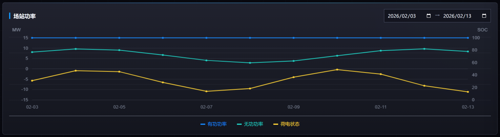

功能概述：

展示当前场站在指定时间范围内的有功功率、无功功率、SOC 等趋势变化，帮助用户回看场站功率运行情况。

输入：

- 当前场站在所选时间范围内的有功/无功功率和 SOC 历史数据。
- 用户选择的开始时间和结束时间。
- 用户在图例中选择查看的指标。

输出：

- 场站功率趋势折线图。
- 有功功率、无功功率、SOC 图例。
- 鼠标悬浮时展示对应时间点的指标明细。

计算规则：

- 时间窗口须满足：0 < 结束时间 - 开始时间 <= 24 小时；校验通过后才查询并刷新趋势图。

1. 默认按最近 24 小时加载趋势数据。
2. 用户修改开始时间或结束时间后，按新的时间范围刷新趋势图。
3. 点击图例时，高亮或隐藏对应指标曲线。

展示要求：

- 起止时间选择支持日期和时分；超出 24 小时时提示“时间范围不能超过 24 小时”，结束时间不晚于开始时间时提示“结束时间须晚于开始时间”。校验不通过时保留原趋势图。

- 图表需展示标题、坐标轴、图例、单位，左轴为功率，右轴为SOC。
- 鼠标悬浮时需同时展示同一时间点各指标值。
- 多条曲线颜色需易于区分，并与图例保持一致。

数据来源：

- 站端 SCADA。
- 云端储能生产数据表。

可配置参数：

| 参数字段   | 默认值    |
| ------ | ------ |
| 默认时间范围 | 最近 24 小时 |
| 最大时间窗口 | 24 小时 |
| 时间粒度 | 按原始数据采样时间点展示 |

#### 2.2.8 场站充放电表现 (Site Charge/Discharge Performance)

界面截图：

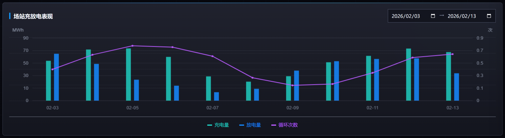

功能概述：

展示当前场站在指定日期范围内的充电量、放电量和循环次数变化，帮助用户回看场站充放电表现。

输入：

- 当前场站在所选日期范围内的充电量、放电量和循环次数历史数据。
- 用户选择的开始日期和结束日期。
- 用户在图例中选择查看的指标。

输出：

- 场站充放电表现组合图。
- 充电量、放电量、循环次数图例。
- 鼠标悬浮时展示对应时间点的充放电明细。

计算规则：

1. 默认按最新一周数据范围加载充放电表现数据。
2. 用户修改开始日期或结束日期后，按新的日期范围刷新图表。
3. 充电量、放电量以柱状图展示，循环次数以折线图展示。
4. 点击图例时，高亮或隐藏对应指标。

展示要求：

- 图表需展示标题、坐标轴、图例、单位，左轴为电量 MWh，右轴为循环次数。
- 充电量、放电量采用不同颜色柱状展示，循环次数采用折线展示。
- 鼠标悬浮时需同时展示同一时间点的充电量、放电量和循环次数。
- 多组数据颜色需易于区分，并与图例保持一致。

数据来源：

- 站端 SCADA。
- 场站充放电历史数据表。

可配置参数：

| 参数字段   | 默认值    |
| ------ | ------ |
| 默认日期范围 | 最新一周数据 |
| 时间粒度   | 天      |

#### 2.2.9 单站预警/告警清单 (Warning/Alarm List)

界面截图：

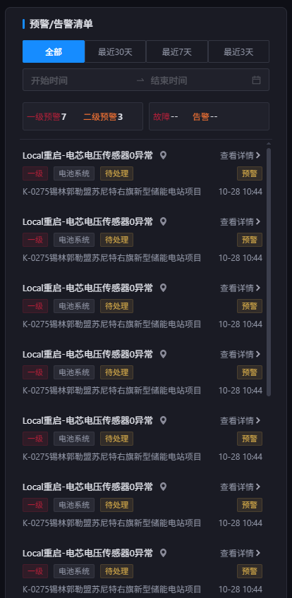

功能概述：

展示当前场站范围内的预警和告警清单，整体布局、筛选方式、统计方式、详情弹窗和处理入口与集中监测首页右侧“预警/告警清单”保持一致。

输入：

- 当前查看的场站。
- 用户选择的预警/告警类型筛选条件。
- 用户选择的时间范围或自定义日期区间。
- 当前场站产生的一级/二级预警和故障/告警记录，不包含三级预警和数据类告警。

输出：

- 当前场站的预警/告警清单。
- 清单顶部展示一级预警、二级预警、故障、告警四类数量。
- 每条记录提供查看详情或进入处理的操作入口。
- 点击清单卡片后打开详情弹窗，弹窗样式、字段和交互与“预警管理”页详情弹窗保持一致。

计算规则：

1. 清单仅展示当前场站范围内的预警和告警。
2. 清单整体规则与 2.1.6 右侧预警/告警清单一致，仅包含一级/二级预警和故障/告警；四类按钮单选高亮，再次点击已选按钮取消类型筛选，不包含三级预警和数据类告警。
3. 类型、时间、日期筛选变更后，同步刷新清单和统计数量。

展示要求：

- 布局、清单卡片字段、时间筛选、分类统计、空态和弹窗交互与集中监测首页右侧“预警/告警清单”一致。
- 清单中的预警/告警记录与拓扑图中子系统悬浮卡片展示的内容保持匹配。

数据来源：

- 云端预警结果表。
- 站端 SCADA。

可配置参数：

| 参数字段   | 默认值         |
| ------ | ----------- |
| 默认时间范围 | 全部          |
| 空态文案   | 当前场站暂无预警/告警 |

### 2.3 单子系统-子系统概览页 (Subsystem Overview)

进入方式：在站级监测页点击拓扑图中的子系统卡片。

单子系统-子系统概览页用于查看当前子系统的运行状态、充放电统计、部件拓扑、趋势图表及该子系统下的预警/告警。整体模块结构与 2.2 站级监测页保持一致，统计口径由“场站”变为“子系统”。

界面截图：

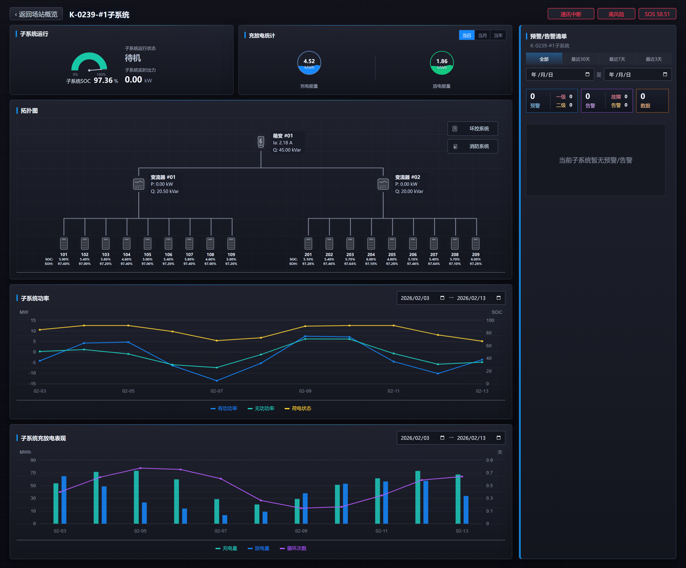

#### 2.3.1 页面入口与顶部信息

界面截图：

功能概述：

展示从站级监测页进入某一子系统后的顶部导航与子系统关键状态，帮助用户确认当前查看对象。

输入：

- 用户在场站拓扑图中点击的子系统卡片。
- 资产树。
- 当前子系统通讯状态、风险等级和 SOS。

输出：

- 打开所选子系统的“单子系统-子系统概览页”。
- 顶部展示返回入口、子系统名称、通讯状态、风险等级和 SOS。

计算规则：

1. 用户点击站级监测页中的子系统卡片后，打开该子系统概览页。
2. 顶部展示内容以当前子系统最新基础信息和状态数据为准。
3. 点击返回入口时，返回站级监测页。

展示要求：

- 展示规则与 2.2.1 页面入口与顶部信息一致，展示对象由场站替换为当前子系统。
- 返回入口需清晰指向站级监测页。
- 子系统名称、通讯状态、风险等级和 SOS 需在首屏清晰可见。

顶部信息：

| 字段    | 说明                       |
| ----- | ------------------------ |
| 返回按钮  | 返回站级监测页                  |
| 子系统名称 | 当前查看子系统，如 `K-0220-#1子系统` |
| 通讯状态  | 所属场站通讯状态                 |
| 风险等级  | 当前子系统 SOS 对应风险等级         |
| SOS   | 当前子系统 SOS                |

数据来源：

- 资产树。
- 站端 SCADA。
- SOS 计算结果表。

#### 2.3.2 子系统运行 (Subsystem Operation)

界面截图：

功能概述：

展示当前子系统的实时运行状态、SOC 和实时出力，描述方式与 2.2.3 场站运行一致，统计对象由场站替换为当前子系统。

输入：

- 当前子系统运行状态。
- 当前子系统 SOC。
- 当前子系统实时出力。

输出：

- 子系统运行状态文本和状态颜色。
- 子系统 SOC 当前值及单位。
- 子系统实时出力当前值及单位。

计算规则：

1. 运行状态、SOC、实时出力取当前子系统最新有效值。
2. 状态颜色、缺失值和单位展示规则与 2.2.3 场站运行一致。

展示要求：

- 指标名称、数值、单位的展示方式与 2.2.3 场站运行一致。
- 离线或缺失数据不得展示为正常状态。

数据来源：

- 站端 SCADA。

#### 2.3.3 子系统充放电统计 (Subsystem Charge/Discharge Statistics)

界面截图：

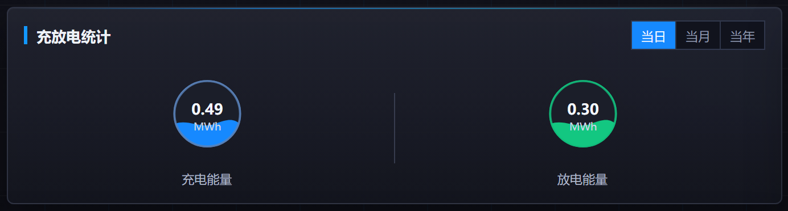

功能概述：

展示当前子系统在当日、当月、当年不同周期内的充电能量和放电能量，描述方式与 2.2.5 充放电统计一致。

输入：

- 当前子系统充电电量统计数据。
- 当前子系统放电电量统计数据。
- 用户选择的统计周期：当日、当月或当年。

输出：

- 所选周期内的子系统充电总量。
- 所选周期内的子系统放电总量。
- 当前选中的统计周期状态。

计算规则：

1. 默认展示当前子系统当日充电总量和放电总量。
2. 当月、当年切换规则与 2.2.5 充放电统计一致。
3. 统计数据按当前子系统维度汇总，单位统一为 MWh。

展示要求：

- 周期切换、数值展示、单位展示和空态规则与 2.2.5 充放电统计一致。

数据来源：

- 场站充放电统计表。

可配置参数：

| 参数字段 | 默认值           |
| ---- | ------------- |
| 统计周期 | 当日/当月/当年，默认当日 |

#### 2.3.4 子系统拓扑图 (Subsystem Topology)

界面截图：

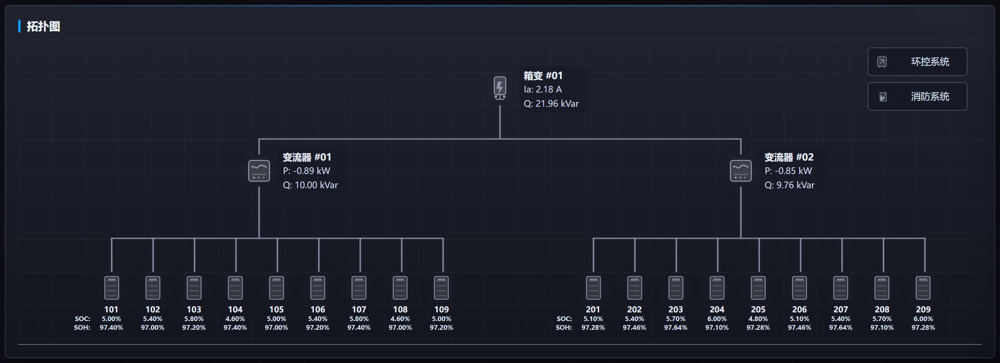

功能概述：

展示当前子系统内部部件拓扑，包括箱变、PCS、电池簇 Rack、环控系统、消防系统等，并支持通过点击部件图标筛选右侧预警/告警清单。

输入：

- 资产树。
- 各部件运行状态、通讯状态和关键运行指标。
- 各部件关联的预警和告警记录。

输出：

- 当前子系统内部拓扑图。
- 箱变、PCS、电池簇、环控系统、消防系统等节点信息。
- 点击部件后的右侧清单筛选条件。

计算规则：

1. 按资产树中当前子系统的部件层级生成拓扑图。
2. 点击部件图标后，右侧预警/告警清单仅展示该部件相关事件；再次点击已选图标取消部件筛选，保留已选类型和时间范围。部件、类型、时间筛选共同生效。
3. 拓扑图仅展示一级/二级预警和故障/告警，三级预警和数据类告警不参与节点事件展示、统计及颜色判定，与右侧清单展示范围一致。

展示要求：

- 拓扑图需清晰展示子系统内部部件连接关系。
- 右侧清单副标题及空态文案需体现当前筛选部件名称。

数据来源：

- 资产树。
- 云端预警结果表。
- 站端 SCADA。

拓扑节点（可配置）：

| 节点   | 说明              |
| ---- | --------------- |
| 箱变   | 展示电流、功率、能量等关键数据 |
| PCS  | 展示电流、功率、能量等关键数据 |
| Rack | 展示SOC、SOH       |
| 环控系统 | 展示环控相关状态        |
| 消防系统 | 展示消防相关状态        |

#### 2.3.5 子系统功率趋势 (Subsystem Power Trend)

界面截图：

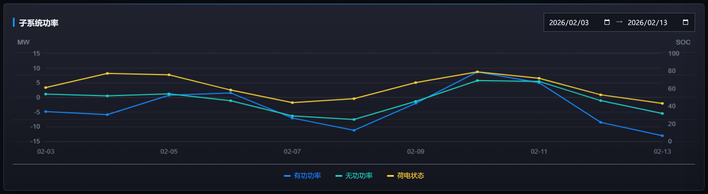

功能概述：

展示当前子系统在指定时间范围内的有功功率、无功功率、SOC 等趋势变化，描述方式与 2.2.7 场站功率趋势一致。

输入：

- 当前子系统在所选时间范围内的有功/无功功率和 SOC 历史数据。
- 用户选择的开始时间和结束时间。
- 用户在图例中选择查看的指标。

输出：

- 子系统功率趋势折线图。
- 有功功率、无功功率、SOC 图例。
- 鼠标悬浮时展示对应时间点的指标明细。

计算规则：

- 时间窗口须满足：0 < 结束时间 - 开始时间 <= 24 小时；校验通过后才查询并刷新趋势图。

1. 默认按最近 24 小时加载趋势数据。
2. 时间范围和图例交互规则与 2.2.7 场站功率趋势一致。

展示要求：

- 起止时间选择支持日期和时分；超出 24 小时时提示“时间范围不能超过 24 小时”，结束时间不晚于开始时间时提示“结束时间须晚于开始时间”。校验不通过时保留原趋势图。

- 图表标题、坐标轴、图例、单位和悬浮提示规则与 2.2.7 场站功率趋势一致。
- 展示对象由场站替换为当前子系统。

数据来源：

- 站端 SCADA。

可配置参数：

| 参数字段   | 默认值    |
| ------ | ------ |
| 默认时间范围 | 最近 24 小时 |
| 最大时间窗口 | 24 小时 |
| 时间粒度 | 按原始数据采样时间点展示 |

#### 2.3.6 子系统充放电表现 (Subsystem Charge/Discharge Performance)

界面截图：

- 当前首屏截图未完整覆盖该区块，局部截图待前端联调补充。

功能概述：

展示当前子系统在指定日期范围内的充电量、放电量和循环次数变化，描述方式与 2.2.8 场站充放电表现一致。

输入：

- 当前子系统在所选日期范围内的充电量、放电量和循环次数历史数据。
- 用户选择的开始日期和结束日期。
- 用户在图例中选择查看的指标。

输出：

- 子系统充放电表现组合图。
- 充电量、放电量、循环次数图例。
- 鼠标悬浮时展示对应时间点的充放电明细。

计算规则：

1. 默认按最新一周数据范围加载充放电表现数据。
2. 日期范围、图例交互、柱状/折线展示规则与 2.2.8 场站充放电表现一致。

展示要求：

- 图表标题、坐标轴、图例、单位和悬浮提示规则与 2.2.8 场站充放电表现一致。
- 展示对象由场站替换为当前子系统。

数据来源：

- 场站充放电统计表。

可配置参数：

| 参数字段   | 默认值    |
| ------ | ------ |
| 默认日期范围 | 最新一周数据 |
| 时间粒度   | 天      |

#### 2.3.7 子系统预警/告警清单 (Warning/Alarm List)

界面截图：

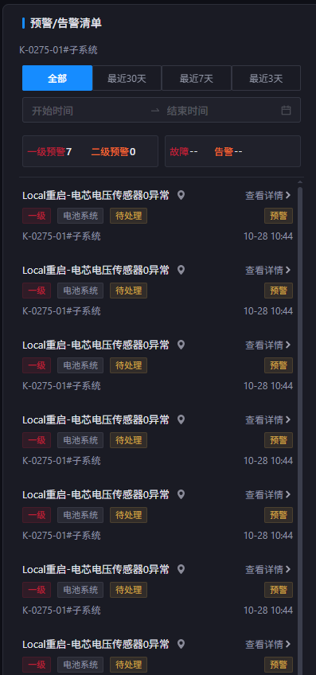

功能概述：

展示当前子系统范围内的预警和告警清单，整体布局、筛选方式、统计方式、详情弹窗和处理入口与 2.2.9 单站预警/告警清单一致。

输入：

- 当前查看的子系统。
- 用户选择的预警/告警类型筛选条件。
- 用户选择的时间范围或自定义日期区间。
- 当前子系统及当前选中部件产生的一级/二级预警和故障/告警记录，不包含三级预警和数据类告警。

输出：

- 当前子系统的预警/告警清单。
- 一级预警、二级预警、故障、告警四类统计数量。
- 每条记录的详情查看入口和处理入口。

计算规则：

1. 清单仅展示当前子系统范围内的预警和告警。
2. 默认规则与 2.1.6 右侧预警/告警清单、2.2.9 单站预警/告警清单一致，仅包含一级/二级预警和故障/告警；四类按钮单选高亮，再次点击已选按钮取消类型筛选，保留当前部件和时间范围。
3. 当用户点击 2.3.4 子系统拓扑图中的部件图标时，清单仅展示该部件相关事件，四类统计数量同步按当前部件及时间范围更新；存在类型筛选时，清单同时按所选类型筛选。

展示要求：

- 布局、清单卡片字段、时间筛选、分类统计、空态和弹窗交互与 2.2.9 单站预警/告警清单一致。
- 清单标题及空态文案需体现当前子系统；存在部件筛选时，副标题及空态文案还需展示当前筛选部件名称。

数据来源：

- 云端预警结果表。
- 站端 SCADA。

可配置参数：

| 参数字段   | 默认值 |
| ------ | --- |
| 默认时间范围 | 全部  |
